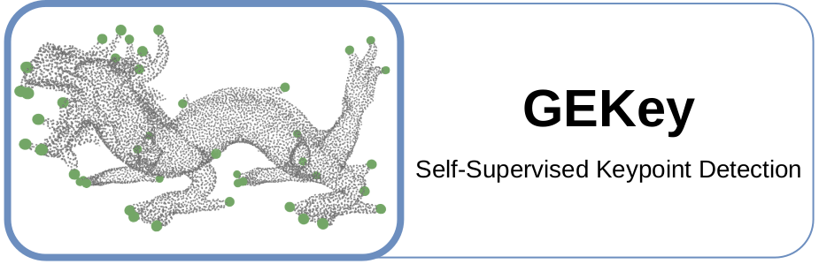

<p align="center">
  <picture>
    <source media="(prefers-color-scheme: dark)" srcset="assets/logo_dark.png">
    
  </picture>
</p>

<p align="center">
  <a href="https://pierreoo.github.io/">Pierre&nbsp;Onghena</a>&emsp;
  <a href="https://people.cmm.minesparis.psl.eu/users/velasco/">Santiago&nbsp;Velasco&#8209;Forero</a>&emsp;
  <a href="https://www.minesparis.psl.eu/en/annuaire-de-la-recherche/chercheur/beatriz-marcotegui-2/">Beatriz&nbsp;Marcotegui</a>
  <br><br>
  <a href="https://pierreoo.github.io/projects/gekey/"></a>
  <!-- Once the preprint is live:
       <a href="https://arxiv.org/abs/XXXX.XXXXX"></a> -->
  
  <a href="https://drive.google.com/drive/folders/1B7YmBxVkaxKoyd8Cf3xEZ4Unb9vnyPDi?usp=sharing"></a>
  <a href="https://bmvc2026.bmva.org/"></a>
</p>

**GEKey** is a self-supervised framework for 3D keypoint detection, supervised by pseudo-labels derived from the geodesic eccentricity transform.

This repository includes the methods as introduced in **GEKey: Learning Geodesic Eccentric 3D Keypoints via Self-Supervision**.


## <br>Datasets

Place each dataset as shown in the [data layout](Pointcept/data/README.md).

### Static Objects

- [ShapeNetCoreV2](https://github.com/AnTao97/PointCloudDatasets): 51300 single-object point clouds across 55 categories, used for training. We consider the 13 categories shared with KeypointNet, with one model trained per category.
- [KeypointNet](https://github.com/qq456cvb/KeypointNet): 8329 keypoint-annotated shapes across 16 categories, used as ground truth for evaluation. Evaluation covers the train/val/test splits of the 13 shared categories.


### Deformable Sequences

- [CAPE](https://cape.is.tue.mpg.de/dataset.html): clothed human bodies registered to the SMPL topology under varied poses and garments.
- [ITOP](https://zenodo.org/records/3932973): real depth-camera captures of human subjects, from which we use the side-view set. Evaluated zero-shot with the CAPE-trained model.
- [DeformingThings4D](https://github.com/rabbityl/DeformingThings4D): animated sequences of deformable objects, of which we use nine animal categories, trained as a single model.


### Preprocessing

The deformable sequences of CAPE, ITOP and DeformingThings4D are converted to point cloud frames before training.
```bash
python Pointcept/data/<dataset>/preprocess.py   # cape, itop, deformingthings
```


### Pseudo-Labels

The pseudo-labels derived from the geodesic eccentricity transform are computed once per dataset configuration and cached under `Pointcept/data/<dataset>/records/`.
The cache is built automatically on the first run and reused afterwards.


## <br>Pre-trained Models

The pre-trained models are available via [Models](https://drive.google.com/drive/folders/1B7YmBxVkaxKoyd8Cf3xEZ4Unb9vnyPDi?usp=sharing).
Place the *exp* folder under `Pointcept`, so that paths resolve as `Pointcept/exp/<dataset>/`.


## <br>Quick Start

Set up the environment following the [Pointcept](Pointcept/README.md#installation) installation.

**Train a model** using a configuration file from `Pointcept/configs`.
This creates an experiment folder under `Pointcept/exp/<dataset>/<exp_name>/` containing checkpoints, logs and evaluation output.
```bash
sh Pointcept/scripts/train.sh -p ${INTERPRETER_PATH} -g ${NUM_GPU} -d ${DATASET_NAME} -c ${CONFIG_NAME} -n ${EXP_NAME}
```

**Test a model** using its experiment name and checkpoint.
```bash
sh Pointcept/scripts/test.sh -p ${INTERPRETER_PATH} -g ${NUM_GPU} -d ${DATASET_NAME} -n ${EXP_NAME} -w ${CHECKPOINT_NAME}
```


## <br>Static Objects

### Training

To train on the airplane category from scratch:
```bash
sh Pointcept/scripts/train.sh -p python -g 1 -d shapenet -c detect -n scratch_airplane
```

To train on another category, set `category` in the [config](Pointcept/configs/shapenet/detect.py), e.g. for chair:
```python
category = 'chair'
```


### Testing

To test the airplane model trained from scratch above:
```bash
sh Pointcept/scripts/test.sh -p python -g 1 -d shapenet -n scratch_airplane -w model_best
```

To test our pre-trained [airplane](https://drive.google.com/drive/folders/1g0RpnHgtbiq7BirA5BOd98oYkTHxxjKt?usp=drive_link) model:
```bash
sh Pointcept/scripts/test.sh -p python -g 1 -d shapenet -n airplane -w model_best
```

Or, to test our other pre-trained [category](https://drive.google.com/drive/folders/1Y-t1-YCZjgRZw3BVL8C1gJP82ZkTBFWf) models:
```bash
sh Pointcept/scripts/test.sh -p python -g 1 -d shapenet -n <category> -w model_best
```


## <br>Deformable Sequences

### Training

To train on CAPE from scratch:
```bash
sh Pointcept/scripts/train.sh -p python -g 1 -d cape -c detect -n scratch_person
```

To train on DeformingThings4D from scratch:
```bash
sh Pointcept/scripts/train.sh -p python -g 1 -d deformingthings -c detect -n scratch_animals
```


### Testing

To test the CAPE model trained from scratch above:
```bash
sh Pointcept/scripts/test.sh -p python -g 1 -d cape -n scratch_person -w model_last
```

To test our pre-trained [CAPE](https://drive.google.com/drive/folders/1DxXIppeuTCA1RgFUudmor0aYe6GrVMoz?usp=drive_link) model:
```bash
sh Pointcept/scripts/test.sh -p python -g 1 -d cape -n person -w model_last
```

To test our pre-trained CAPE model zero-shot on ITOP, use the [ITOP](https://drive.google.com/drive/folders/1xc47S84AMjQQkz3vpQcd_OJxRWkWItaT?usp=drive_link) folder:
```bash
sh Pointcept/scripts/test.sh -p python -g 1 -d itop -n person -w model_last
```

To test our pre-trained [DeformingThings4D](https://drive.google.com/drive/folders/1bHvSvzg6ENU5CaFMez7adaDab-Z6ReTM?usp=drive_link) model:
```bash
sh Pointcept/scripts/test.sh -p python -g 1 -d deformingthings -n animals -w model_last
```


## <br>Geometric Analysis

The geometric analysis of the pseudo-labels (GEKey-PL) is implemented under `method/`.

Analyze the [Stanford dragon](https://github.com/alecjacobson/common-3d-test-models):
```bash
python method/dragon.py
```

Analyze a single KeypointNet category with per-shape visualization, airplane by default:
```bash
python method/keypointnet.py
```

Run the geometric analysis across all categories:
```bash
python method/keypointnet_all.py
```

Run a runtime analysis of the individual components:
```bash
python method/keypointnet_runtime.py
```


## <br>License

<a href="LICENSE"></a>
<a href="Pointcept/LICENSE"></a>

The datasets listed above are not covered by these licenses and remain subject to their own terms.

## <br>Citation

If you find *GEKey* useful to your research, please consider citing:
```bibtex

```
